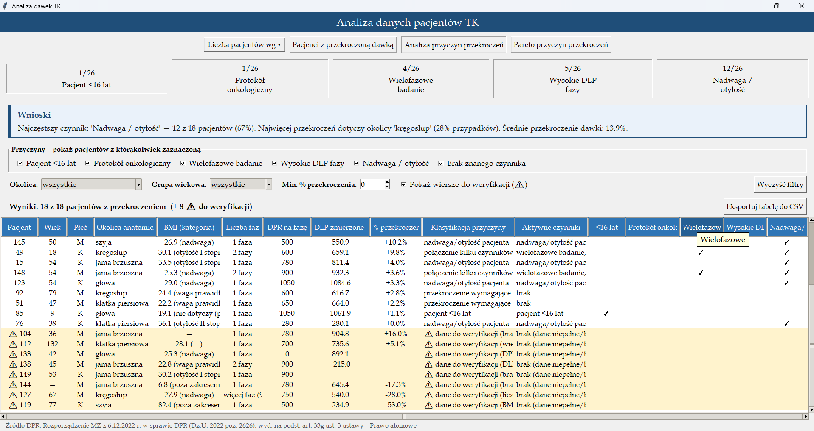
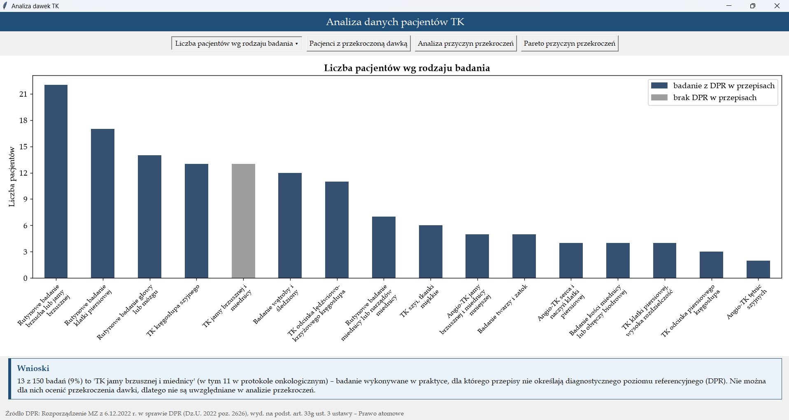
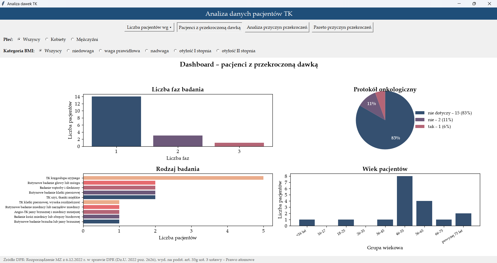
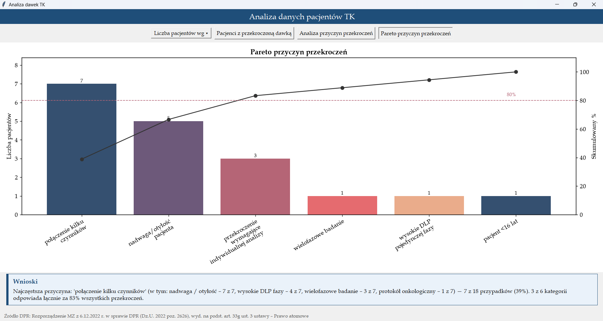

# Analiza dawek TK

Jest to desktopowa aplikacja w Pythonie, opierająca się na Tkinter, matplotlib i pandas. Służy do analizy dawek promieniowania w badaniach tomografii komputerowej (TK). Program wczytuje dane pacjentów z pliku CSV, porównuje zmierzone DLP z diagnostycznym poziomem referencyjnym (DPR) określonym w przepisach, wykrywa przekroczenia, wskazuje ich prawdopodobne przyczyny i prezentuje wyniki na wykresach, w tabelach i w automatycznie generowanych wnioskach. Pokazuje też badania wykonywane w praktyce, dla których przepisy nie określają DPR.

> **Specyfikacja aplikacji** (opis wyglądu i działania, na podstawie którego powstawał interfejs): [SPECYFIKACJA.md](SPECYFIKACJA.md)



---

## Funkcje

**Liczebność pacjentów** (przycisk rozwijany „Liczba pacjentów wg ▾”)
- wg rodzaju badania – wykres słupkowy; badania bez DPR w przepisach (TK jamy brzusznej i miednicy) wyróżnione na szaro, z legendą i panelem wniosków o ich liczbie i udziale,
- wg grupy wiekowej – 9 grup: <16 lat, 16-17, 18-25, …, powyżej 75 lat,
- wg płci – wykres kołowy.

**Pacjenci z przekroczoną dawką** – dashboard 2×2
- liczba faz badania, protokół onkologiczny (wykres kołowy z legendą), rodzaj badania, wiek pacjentów,
- filtry płci i kategorii BMI – wszystkie wykresy odświeżają się od razu po zmianie filtra.

**Analiza przyczyn przekroczeń**
- karty z liczbą pacjentów dla 5 czynników przekroczenia: wiek <16 lat, protokół onkologiczny, badanie wielofazowe, wysokie DLP fazy, nadwaga/otyłość,
- automatycznie generowane wnioski,
- filtry: przyczyny, okolica anatomiczna, grupa wiekowa, minimalny % przekroczenia, wiersze do weryfikacji, przycisk „Wyczyść filtry”,
- tabela pacjentów z DPR i DLP na fazę, % przekroczenia, klasyfikacją przyczyny i znacznikami czynników,
- tooltipy: definicje DPR i DLP na nagłówkach kolumn, opisy klasyfikacji przyczyn, wyjaśnienie dla wierszy do weryfikacji, pełna treść uciętych komórek.

**Pareto przyczyn przekroczeń**
- słupki liczebności przyczyn, linia skumulowanego % i próg 80%,
- wnioski: najczęstsza przyczyna (z rozbiciem na składowe czynniki przy „połączeniu kilku czynników”) i liczba kategorii odpowiadających za 80% przypadków.

**Walidacja danych**
- wiersze z brakami lub wartościami spoza zakresu nie są usuwane, tylko oznaczane jako „do weryfikacji” (⚠, żółte tło) z opisem powodu,
- w tabeli pokazywane są wszystkie poprawne dane takiego wiersza, a „—” tylko w miejscu błędnej lub brakującej wartości,
- wykresy i statystyki pomijają takie wiersze, żeby nie zafałszowały wyników,
- brak DPR dla badań nieujętych w przepisach nie jest traktowany jako błąd danych.

**Interfejs**
- stopka ze źródłem wartości referencyjnych widoczna we wszystkich widokach,
- okno wyśrodkowane w obszarze roboczym ekranu, ostre czcionki przy skalowaniu ekranu Windows (125%, 150%),
- wykresy dopasowują się do rozmiaru okna, długie etykiety są zawijane,
- spójna czcionka i kolorystyka.

---

## Wymagania

- Windows 10 lub 11 (na Linuksie/macOS aplikacja działa bez wyśrodkowania w obszarze roboczym i obsługi skalowania ekranu, które korzystają z API Windows),
- Python 3.10 lub nowszy – z python.org albo w dystrybucji Anaconda (obie zawierają Tkinter),
- biblioteki z pliku `requirements.txt`: pandas, matplotlib (w wersji co najmniej 3.7).

---

## Instalacja

```bash
git clone https://github.com/PacerHub/ProjektI.git
cd ProjektI

python -m venv .venv
.venv\Scripts\activate          # Windows
# source .venv/bin/activate     # Linux / macOS

pip install -r requirements.txt
```

W PyCharmie: **File → Open** (folder projektu) – PyCharm zaproponuje utworzenie środowiska i instalację pakietów z `requirements.txt`.

---

## Uruchomienie

```bash
python uruchom.py
```

lub w PyCharmie: prawy przycisk myszy na `uruchom.py` → **Run 'uruchom'**.

Aplikacja od razu wczytuje przykładowe dane z pliku `ct_patients_data.csv` i otwiera widok „Liczba pacjentów wg rodzaju badania”.

---

## Przykładowe dane

Plik `ct_patients_data.csv` zawiera **150 fikcyjnych badań** (dane nie dotyczą rzeczywistych pacjentów):

- 142 poprawne wiersze, w tym 18 pacjentów z przekroczoną dawką,
- 13 badań „TK jamy brzusznej i miednicy” (11 w protokole onkologicznym) – badanie wykonywane w praktyce, dla którego rozporządzenie nie określa DPR; kolumny z wartościami referencyjnymi są puste,
- 8 celowo błędnych wierszy, z których każdy łamie inną regułę walidacji:

| Pacjent | Problem |
|---|---|
| 104 | brak BMI |
| 112 | wiek 132 lata (poza zakresem 0–110) |
| 119 | BMI 82,4 (poza zakresem 10–70) |
| 127 | 9 faz (poza zakresem 1–6) |
| 133 | DPR = 0 |
| 138 | ujemne DLP |
| 144 | brak wieku i BMI 6,8 – dwa problemy naraz |
| 149 | brak zmierzonego DLP |

**Kolumny pliku CSV:** `patient_id`, `wiek`, `plec` (K/M), `bmi`, `rodzaj_badania_tk`, `protokol_onkologiczny_jamy_brzusznej` (True/False/puste), `liczba_faz`, `ctdiw_referencyjny_mGy`, `ctdiw_zmierzony_mGy`, `dlp_referencyjny_na_faze_mGy_cm`, `dlp_zmierzony_na_faze_mGy_cm`, `dlp_zmierzony_lacznie_mGy_cm`.

---

## Źródło wartości referencyjnych (DPR)

Wartości referencyjne CTDIw i DLP pochodzą z **Rozporządzenia Ministra Zdrowia z dnia 6 grudnia 2022 r. w sprawie diagnostycznych poziomów referencyjnych** (Dz.U. 2022 poz. 2626, załącznik nr 1, tabela 3), wydanego na podstawie **art. 33g ust. 3 ustawy z dnia 29 listopada 2000 r. – Prawo atomowe**.

- Tekst aktu: [eli.gov.pl – Dz.U. 2022 poz. 2626](https://eli.gov.pl/eli/DU/2022/2626/ogl)
- Wartości dotyczą standardowego pacjenta dorosłego (170 cm, 70 kg); DLP podawane jest dla jednej fazy badania.
- Tabela obejmuje 17 rodzajów badań TK. Nie ma w niej łączonego badania **jamy brzusznej i miednicy** (poza angio-TK) ani wartości dla badań TK u dzieci.

W aplikacji źródło jest zapisane w stałych `ZRODLO_DPR` i `ZRODLO_DPR_KROTKO` w `stale.py`, a badania nieujęte w rozporządzeniu – w stałej `BADANIA_BEZ_DPR`.

> Przed wykorzystaniem wyników warto sprawdzić w ISAP, czy rozporządzenie nie zostało zmienione.

---

## Struktura projektu

```
├── uruchom.py               # punkt startowy: okno, nagłówek, stopka, przyciski, przełączanie widoków
├── stale.py                 # stałe: ścieżka danych, progi, etykiety, kolory, kolumny tabel, źródło DPR, opisy tooltipów
├── przetwarzanie_danych.py  # wczytanie CSV, walidacja, analiza pojedynczego pacjenta, filtry
├── agregacje.py             # zliczenia, filtrowanie przyczyn, generowanie wniosków
├── wykresy.py               # budowa wykresów matplotlib
├── komponenty.py            # elementy GUI wielokrotnego użytku: tabela, panele, filtry, tooltipy
├── widoki.py                # ekrany aplikacji (m.in. klasa WidokAnalizyPrzyczyn)
├── ct_patients_data.csv     # przykładowe dane: 150 badań, w tym 8 błędnych wierszy
├── requirements.txt
├── README.md
├── SPECYFIKACJA.md          # specyfikacja wyglądu i działania aplikacji
└── docs/zrzuty/             # zrzuty ekranu do README
```

Logika obliczeń (`przetwarzanie_danych`, `agregacje`) nie zależy od Tkintera – interfejs korzysta z niej, ale można ją testować bez uruchamiania okna.

---

## Zrzuty ekranu

| | |
|---|---|
|  |  |
| Liczba pacjentów wg rodzaju badania – badania bez DPR na szaro | Dashboard z filtrami płci i BMI |
|  |  |
| Analiza przyczyn z filtrami, tabelą i wierszami ⚠ | Pareto przyczyn z wnioskami |

---

## Przebieg prac

Historia commitów (ponad 120 commitów, wrzesień–październik 2026) pokazuje kolejne etapy:

| Etap | Okres | Co powstało |
|---|---|---|
| 1. Aplikacja jednoplikowa | 5–15.09 | tabela pacjentów z przekroczoną dawką, dymki nad kursorem, przyciski widoków, analiza przyczyn z BMI, porównanie DLP dla pojedynczej fazy |
| 2. Podział na moduły | 17–18.09 | rozbicie jednego pliku na moduły (stałe, przetwarzanie danych, agregacje, wykresy, komponenty, widoki), dashboard 2×2 |
| 3. Rozbudowa analizy | 20–24.09 | walidacja danych, wykres Pareto, automatyczne wnioski, polskie nazwy modułów, czcionki i kolory, przycisk rozwijany |
| 4. Zalecenia prowadzącego | 1–13.10 | filtry płci i BMI w dashboardzie, wydzielenie logiki filtrowania, wnioski z rozbiciem na czynniki składowe |
| 5. Dopracowanie | 20–24.10 | panel wniosków, tooltipy, filtry w analizie przyczyn, badania bez DPR i źródło prawne DPR, kolumny DPR i DLP z definicjami, dane 150 badań, klasa widoku analizy przyczyn, dokumentacja |

---

## Wykorzystanie AI

W projekcie korzystałam z asystenta AI **Claude (Anthropic)** w zakresie dopuszczonym przez prowadzącego: generowanie GUI na podstawie mojej specyfikacji, pomoc przy logice, szukanie błędów i tworzenie dokumentacji.

### 1. Specyfikacja → interfejs (GUI)

Wygląd i działanie aplikacji opisałam w specyfikacji ([SPECYFIKACJA.md](SPECYFIKACJA.md)): jakie widoki ma mieć aplikacja, co ma się znaleźć w tabelach i na wykresach, jak mają działać filtry, tooltipy i wnioski. Na jej podstawie AI generowało kod interfejsu (Tkinter, matplotlib) – m.in. w rozmowie „Normy dawek promieniowania w Prawie Atomowym”. Specyfikację rozwijałam razem z aplikacją: każde nowe wymaganie (np. kolumny DPR i DLP z definicjami, wyróżnienie badań bez DPR, pokazywanie poprawnych danych w wierszach do weryfikacji) najpierw opisywałam, a potem wdrażałam w kodzie wygenerowanym przez AI.

### 2. Logika aplikacji

Założenia merytoryczne są moje:

- porównywanie zmierzonego DLP z DPR dla **pojedynczej fazy** (a nie mnożenie wartości referencyjnych przez liczbę faz),
- zestaw czynników przekroczenia, w tym BMI,
- oparcie wartości referencyjnych na rozporządzeniu wydanym na podstawie ustawy Prawo atomowe,
- wskazanie luki w przepisach: badania TK jamy brzusznej i miednicy (także w protokole onkologicznym) są w praktyce często wykonywane, a rozporządzenie nie określa dla nich DPR,
- liczenie udziału tych badań względem wszystkich wykonanych badań (także z błędnie zapisanymi danymi, bo badanie zostało wykonane),
- podział grup wiekowych (18-latkowie w osobnej grupie niż 16–17 lat),
- oznaczanie błędnych danych zamiast ich usuwania, z pokazaniem wszystkich poprawnych wartości takiego wiersza.

AI pomagało przełożyć te założenia na kod: walidację danych, filtrowanie, wyliczenia do wykresu Pareto, generowanie wniosków, podział projektu na moduły i przebudowę widoku analizy przyczyn na klasę. AI wygenerowało też według moich założeń pacjentów 101–150 w przykładowych danych.

### 3. Szukanie błędów

AI pomagało diagnozować błędy na podstawie komunikatów (`ImportError`, `IndentationError`, `AttributeError`, `ZeroDivisionError`) oraz wyjaśniało ich przyczyny, np. błędne wcięcia, brakujące importy, metody usunięte przy wklejaniu kodu, dzielenie przez zero przy DPR = 0. Problemy w działaniu aplikacji wykrywałam sama, testując każdą zmianę – m.in. skalę osi co 0,2 przy jednym pacjencie, nieczytelny histogram wieku, ucinane etykiety osi i tooltipy przy krawędzi ekranu, powtórzoną liczbę we wnioskach, puste kolumny w wierszach do weryfikacji.

### Mój udział

Decydowałam o zakresie i kierunku projektu, pisałam specyfikację, wnosiłam wiedzę dziedzinową, wybierałam spośród proponowanych rozwiązań, wdrażałam i dostosowywałam kod w PyCharmie, krok po kroku, nie kopiowałam gotowych plików w całości, testowałam każdą zmianę i zapisywałam w repozytorium dopiero działającą wersję. 

---

## Autorka

Patrycja Ślesicka – Projekt Semestralny I, Analityka danych biologiczno-medycznych, 2026
